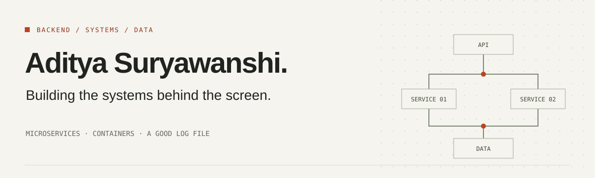

# Hey, I'm Aditya 👋

I build backend services, break monoliths into microservices, and put things in Docker containers. Most days, I work with **Node.js, Ruby on Rails, and Python**. C++ will always be my first love.

I've worked across the stack, but backend engineering is where I feel at home. Give me a weird production bug and a log file, and I'm happy.

[LinkedIn ↗](https://www.linkedin.com/in/suryawanshiaditya/) · [Email ↗](mailto:adityams.dev@gmail.com) · [Project repositories ↗](https://github.com/aditya2907?tab=repositories)

---

## What I work on

| Backend engineering | Systems & data |
| :--- | :--- |
| APIs, services, and monolith-to-microservice migrations | Containerized applications and reliable data workflows |
| Node.js · Ruby on Rails · Python | Docker · PostgreSQL · MySQL · MongoDB · Redis |

### In the toolkit

**Languages** &nbsp; `C++` `Python` `JavaScript` `Java` `Ruby`

**Backend** &nbsp; `Node.js` `Ruby on Rails` `Docker`

**Databases** &nbsp; `PostgreSQL` `MySQL` `MongoDB` `Redis`

**Frontend, when needed** &nbsp; `HTML` `CSS`

## Selected projects

### [TensorFleet ↗](https://github.com/aditya2907/TensorFleet)
A distributed ML training platform with an API gateway, orchestration services, and compute workers. Built around scalable execution, fault tolerance, and observability.

`Python` `Go` `FastAPI` `TensorFlow` `Docker` `Kubernetes`

### [Explainable fraud detection ↗](https://github.com/aditya2907/Financial-Fraud-Detection-using-Explainable-AI)
Fraud analytics with ensemble models and explanations that help make model decisions understandable. Includes scoring pipelines and an interactive dashboard.

`Python` `XGBoost` `LightGBM` `SHAP` `LIME` `Streamlit`

### [P2P lending platform ↗](https://github.com/aditya2907/P2P-Lending-System)
Full-stack lending workflows covering origination, funding, repayment, and settlement, with smart contracts and role-based access.

`Python` `Solidity` `SQL` `React`

---

## Let's build something useful

Have a project idea, a backend challenge, or an opportunity to collaborate? [Let's talk on LinkedIn.](https://www.linkedin.com/in/suryawanshiaditya/)
